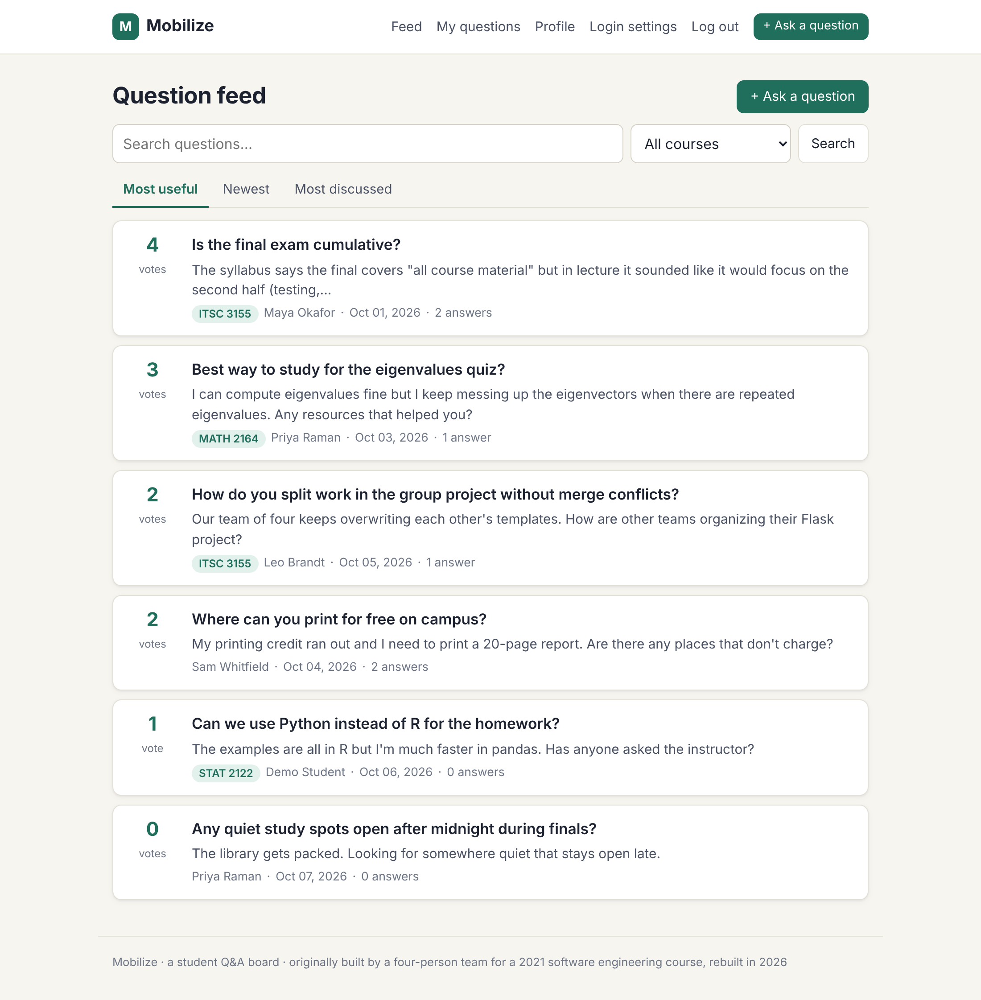
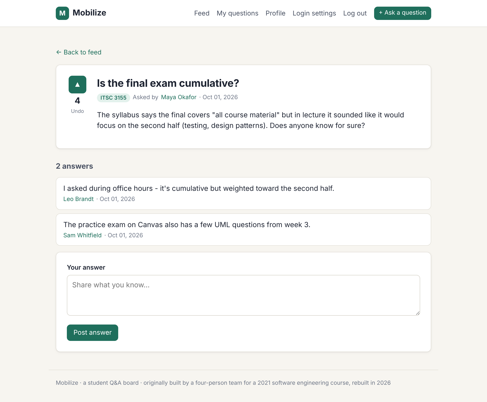
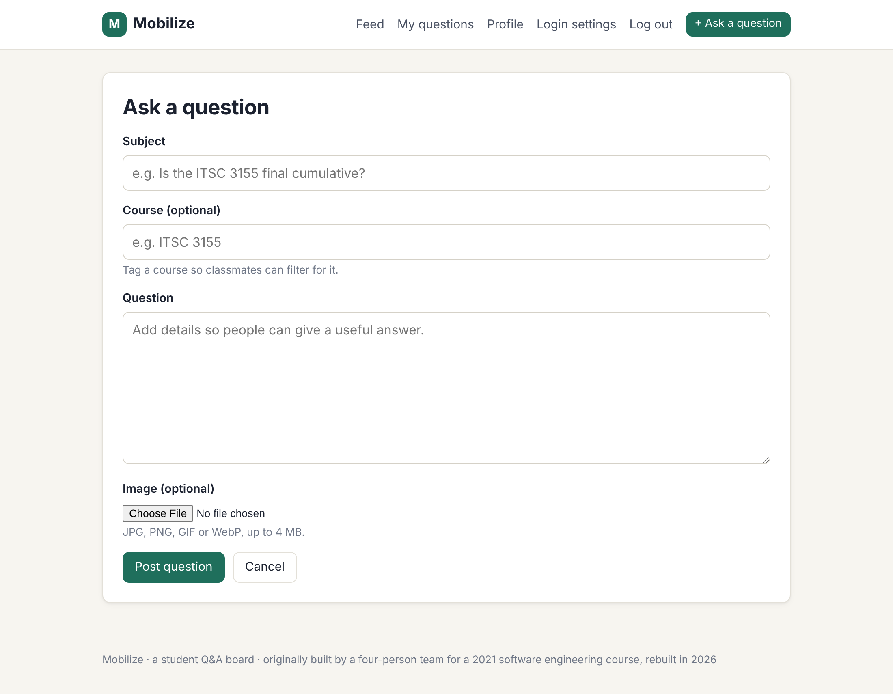
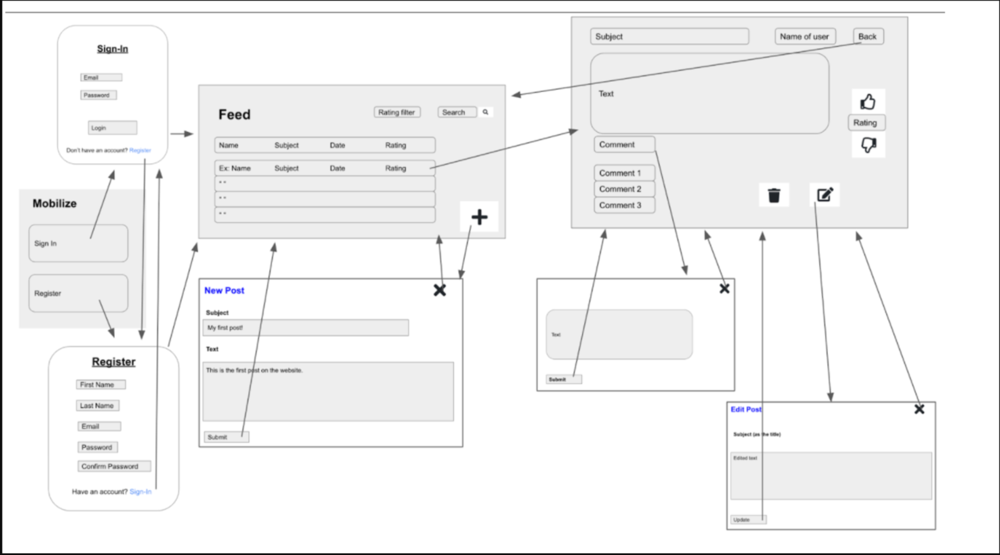
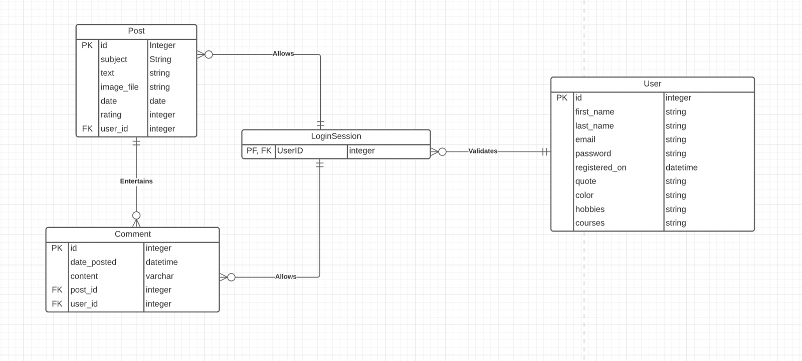
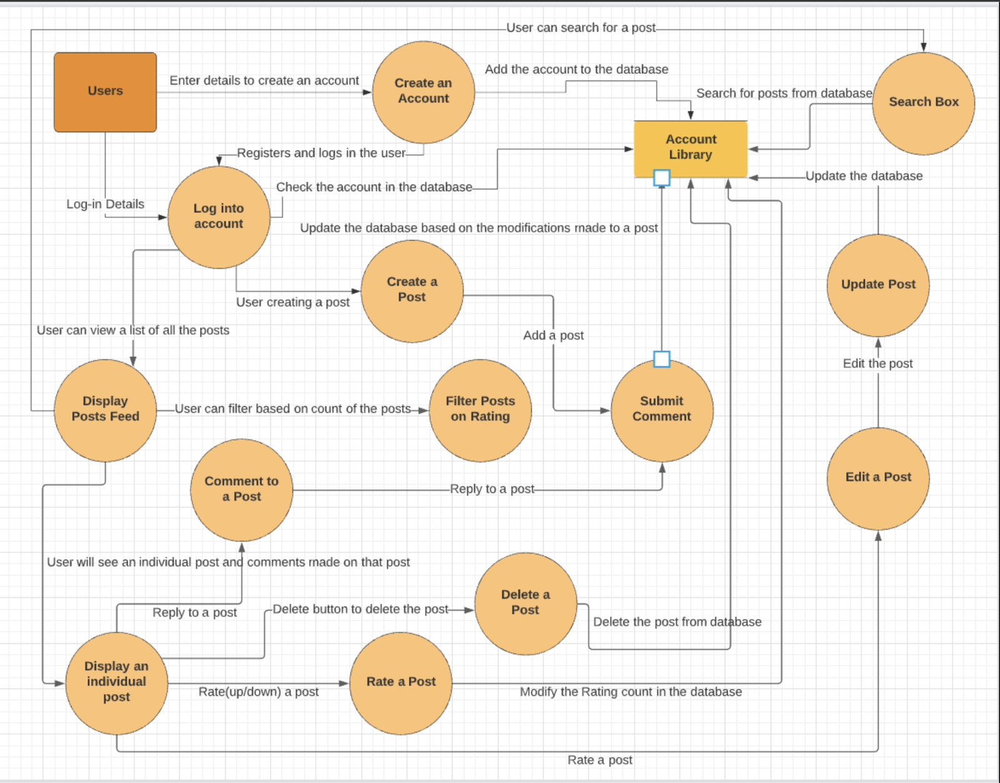
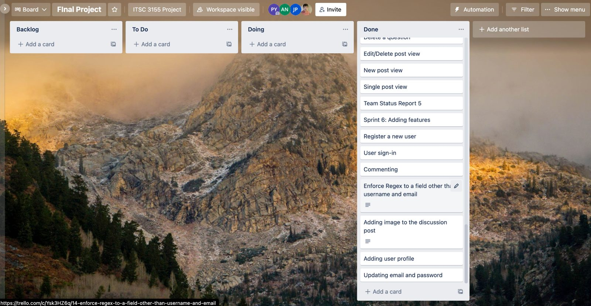

# Mobilize

**A Q&A discussion board for university students.** Students post questions about a course or about campus life, answer each other, and upvote the questions that help. The feed ranks questions by usefulness, so the questions most students need answered are at the top.



> **Project context:** Mobilize was the final project for ITSC 3155 *Software Engineering* (Fall 2021, instructor Dr. Nadia Najjar). A four-person team designed and built it: **Asad Noman, Jay Patel, Stone Zheng and Prachi Yadav**.
>
> **This repository is a 2026 rebuild.** The original 2021 source code was not kept. I rebuilt the app from the team's design documents (user stories, wireframes, ERD and data-flow diagram, all included below) and from the parts of the original code that survived. The rebuild also completes or fixes several things the 2021 version left unfinished. See [What changed in the rebuild](#what-changed-in-the-rebuild).

---

## Features

| Feature | What it does |
|---|---|
| **Accounts** | Register, log in and log out. Passwords are hashed and must meet a complexity rule. |
| **Ask** | Post a question with an optional course tag (e.g. `ITSC 3155`) and an optional image. |
| **Answer** | Comment on any question. |
| **Rate** | Upvote a question once, and undo the vote by clicking again. |
| **Feed** | Sort by *Most useful*, *Newest* or *Most discussed*. Search by text and filter by course. A *My questions* view shows only your own posts. |
| **Manage** | Edit or delete your own questions. Only the author can do this. |
| **Profiles** | Optional quote, courses, hobbies and favorite color, visible to other students. |
| **Login settings** | Change your email and/or password after confirming your current password. |

<table>
  <tr>
    <td></td>
    <td></td>
  </tr>
  <tr>
    <td align="center"><sub>Question page with upvote / undo and answers</sub></td>
    <td align="center"><sub>Asking a question with a course tag and image</sub></td>
  </tr>
</table>

## My role on the 2021 team

The team divided the work by user story. My parts were:

- **Create a question/post**: the new-post form and flow from the feed.
- **Edit a question/post**: the edit form, available from the single-post page.
- **Image upload on posts**: storing uploaded images so they can be shown in the feed and on the post.
- **Update email and password**: the login-credentials page and route.
- **Password rule**: enforcing a regex on the password field (letter, number, special character).

My teammates owned registration and sign-in (Asad), the feed and single-post views (Jay), and commenting and deleting posts (Stone). We tracked sprints on a shared Trello board.

## What changed in the rebuild

| Area | 2021 team version (— = not documented) | 2026 rebuild |
|---|---|---|
| Password storage on update | The current password was compared directly against the stored value, and the new password was saved without re-encrypting. The team flagged this as an ethical flaw in the final report. | Passwords are always stored as salted hashes (`werkzeug.security`) and checked against the hash. |
| Rating | Upvote and undo changed a counter, so one user could vote repeatedly. The team tried a `hasVoted` flag but couldn't finish it. | A `Vote` table with a unique `(post_id, user_id)` constraint means one vote per user, and clicking again undoes it. |
| Feed | Listed all posts. The wireframes planned search and a rating filter. | Search, course filter, and sorting by most useful, newest or most discussed are implemented. |
| Authorization | — | Only the author can edit or delete a question (HTTP 403 otherwise). |
| Upload & form security | — | CSRF tokens on every form (Flask-WTF). Images are type-checked, size-limited (4 MB) and stored under random names. |
| Password rule | 6+ characters (spec said 6–12) with a letter, number and special character. | 8+ characters with a letter, number and special character, and no maximum length. |
| Course tag | — | Optional course tag on questions, used for filtering. |
| Tests | — | 21 automated tests based on the original user stories and acceptance criteria, run in CI. |
| Structure | — | Application factory with blueprints (`auth`, `posts`, `account`). |

## Original design documents (2021)

These are the team's original artifacts from the final project report.

**Wireframes**: sign-in, register, feed, new post, single post, comment and edit flows.


**Entity-relationship diagram**: the rebuild keeps `User`, `Post` and `Comment` as designed. It replaces the integer `rating` column with a `Vote` table and handles sessions with Flask's signed cookie instead of a `LoginSession` table.


**Data-flow diagram**


<details>
<summary><b>Trello board</b> (final sprint)</summary>


</details>

## Tech stack

Python 3.10+ · Flask 3 · Flask-SQLAlchemy (SQLite) · Flask-WTF / WTForms · Jinja2 · plain CSS (no framework) · pytest · GitHub Actions

## Running locally

```bash
git clone https://github.com/<your-username>/mobilize.git
cd mobilize
python -m venv .venv && source .venv/bin/activate   # Windows: .venv\Scripts\activate
pip install -r requirements.txt

flask --app mobilize seed        # optional: load demo questions and users
flask --app mobilize run
```

Open http://127.0.0.1:5000. With demo data loaded, log in as `demo@example.edu` / `Demo#2021`.

Configuration is read from environment variables:

| Variable | Default | Purpose |
|---|---|---|
| `MOBILIZE_SECRET_KEY` | `dev-only-change-me` | Session signing key. Set a random value outside development. |
| `DATABASE_URL` | `sqlite:///instance/mobilize.db` | Any SQLAlchemy database URL. |

## Tests

```bash
pip install -r requirements-dev.txt
pytest
```

Each test maps to one of the team's original user stories: registering, signing in, creating, viewing, editing and deleting posts, commenting, rating, profiles, credential updates and the password rule. There are also tests for the rebuild's fixes: one vote per user, author-only edits, hashed password updates and upload validation.

## Project structure

```
mobilize/
├── __init__.py        # app factory, CLI commands (init-db, seed)
├── models.py          # User, Post, Comment, Vote
├── forms.py           # WTForms forms and the password rule
├── auth.py            # register / login / logout, login_required
├── posts.py           # feed, search/sort, post CRUD, comments, voting, uploads
├── account.py         # profiles and login settings
├── seed.py            # demo data
├── templates/         # Jinja templates
└── static/style.css
tests/                 # pytest suite
docs/                  # original 2021 design docs and screenshots
scripts/screenshots.py # regenerates the screenshots with Playwright
```

## License

MIT. See [LICENSE](LICENSE). The design documents in `docs/images` are the original work of the 2021 team.
